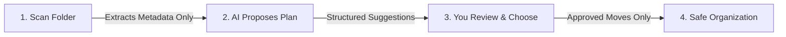

# 🦥 SlothDesk

> **A calmer, privacy-first way to organize your files using local AI.**  
> *Built for Hacktoberfest 2026 — "Slow and Steady".*

[](https://fastapi.tiangolo.com)
[](https://react.dev/)
[](https://www.typescriptlang.org/)
[](https://ollama.com)
[](https://www.python.org/)
[](https://opensource.org/licenses/MIT)

---

## Table of Contents

1. [What is SlothDesk?](#-what-is-slothdesk)
2. [Why SlothDesk? (The Need & Usefulness)](#-why-slothdesk-the-need--usefulness)
3. [How It Works](#-how-it-works)
4. [Key Features](#-key-features)
5. [Supported File Categories](#-supported-file-categories)
6. [Quick Start Guide (For Absolute Beginners)](#-quick-start-guide-for-absolute-beginners)
   - [Step 1: Install & Start Ollama](#step-1-install--start-ollama)
   - [Step 2: Set Up the Backend](#step-2-set-up-the-backend)
   - [Step 3: Set Up the Frontend](#step-3-set-up-the-frontend)
   - [Step 4: Organize Your Files!](#step-4-organize-your-files)
7. [How to Use the App (Step-by-Step Walkthrough)](#-how-to-use-the-app-step-by-step-walkthrough)
8. [Configuration Options](#-configuration-options)
9. [Architecture Overview](#-architecture-overview)
10. [Privacy & Safety Guarantees](#-privacy--safety-guarantees)
11. [Troubleshooting & FAQ](#-troubleshooting--faq)
12. [Contributing](#-contributing)

---

## 🦥 What is SlothDesk?

**SlothDesk** is a desktop file organization assistant that brings order to cluttered folders (like your `Downloads` or `Desktop`) without compromising your privacy.

Unlike traditional automated scripts that blindly move files according to rigid rules, or cloud tools that require uploading your sensitive personal files to external servers, SlothDesk:
- Runs **100% locally on your machine**.
- Uses an **open-weight AI model (`qwen3:4b`) via Ollama** to intelligently understand file types and contexts.
- **Never moves a single file without your explicit review and approval**.
- **Never deletes anything**.

Like a sloth, it is deliberate, safe, and steady — keeping you in total control at every step.

---

## Why SlothDesk? (The Need & Usefulness)

### The Problem: The "Digital Junk Drawer"
Almost every computer user suffers from messy folders:
- **`Downloads` folder chaos**: Invoices mixed with resumes, video clips, random `.zip` files, software `.dmg`/`.exe` installers, school notes, and downloaded images.
- **Fear of accidental deletion**: You hesitate to clean it up because you don't know what might still be important.
- **Time-consuming manual sorting**: Manually creating folders like `Invoices/`, `Code/`, `Resumes/`, and dragging hundreds of files takes hours.
- **Privacy risks with Cloud AI**: Uploading your tax documents, contracts, bank statements, or personal resumes to cloud services (like ChatGPT or Google Drive AI) exposes sensitive data to third parties.

### The Solution: How SlothDesk Solves This
| Challenge | Traditional Cleaners | Cloud AI Cleaners | SlothDesk |
|---|---|---|---|
| **Privacy** | Local, but dumb regex | ❌ Uploads files to cloud | ✅ **100% Local (zero cloud calls)** |
| **Intelligence** | ❌ Rigid extension rules | High, but risky | ✅ **Smart local LLM classification** |
| **Safety** | ❌ Can delete files automatically | ❌ Can alter file contents | ✅ **Read-only scanning & approval modal** |
| **Rollback & Safety** | ❌ Moves immediately | ❌ Hard to revert | ✅ **Fingerprint verification & atomic moves** |
| **Transparency** | Black box | Black box | ✅ **Shows reasons for every suggestion** |

---

## How It Works

SlothDesk operates in a simple, non-destructive **4-step workflow**:



1. **Scan**: SlothDesk inspects your chosen folder (e.g., `~/Downloads`). It reads only metadata — filenames, file extensions, and file sizes. **It never reads file contents or alters anything.**
2. **AI Plan**: Metadata is passed to a local Ollama model (`qwen3:4b`). The model analyzes file names and context (e.g., `invoice_mar_2024.pdf` → `Invoices`, `script.py` → `Code`, `podcast.mp3` → `Audio`).
3. **User Review**: The web dashboard displays all suggested moves along with the reason behind each suggestion. You can filter by category, check or uncheck individual items, or select all.
4. **Safe Apply**: When you click **"Confirm and organize"**, the backend validates every destination, checks for conflicts, records an audit log to SQLite, and safely moves the approved files into organized subdirectories.

---

## Key Features

-  **Smart Local AI Reasoning**: Uses locally hosted `qwen3:4b` to categorize files based on semantic meaning, not just file extensions.
- **10 Distinct File Categories**: Categorizes into `Documents`, `Images`, `Audio`, `Video`, `Code`, `Data`, `Invoices`, `Resumes`, `Notes`, and `Other`.
- **Interactive File Explorer**: Real-time search and inventory browser with dynamic icons tailored for code, databases, media, and documents.
- **Two-Phase Move Protection**: Verifies that sources exist, destinations do not collide, symlinks are rejected, and path traversals (`../`) are blocked.
- **Duplicate File Detection**: Scans for identical duplicate files using fast SHA-256 content hashing without altering or deleting them.
- **Session Activity Audit**: Keeps track of every moved and skipped file in a local SQLite database for complete transparency.
- **Modern Dark / Light Mode**: Beautiful UI with curated palettes, accessible contrasts, and automatic theme memory.

---

##  Supported File Categories

SlothDesk automatically maps and categorizes hundreds of file formats:

| Category | Destination Folder | Examples of Supported Extensions | Example Files |
|---|---|---|---|
| **Code** | `Code/` | `.py`, `.js`, `.ts`, `.tsx`, `.jsx`, `.cpp`, `.c`, `.h`, `.java`, `.rs`, `.go`, `.html`, `.css`, `.php`, `.sh`, `.swift`, `.rb`, `.vue`, `.sql` | `app.py`, `index.html`, `main.cpp` |
| **Data** | `Data/` | `.json`, `.csv`, `.tsv`, `.sql`, `.sqlite`, `.parquet`, `.xml`, `.yaml`, `.yml`, `.toml`, `.ini`, `.xlsx`, `.xls` | `sales_2024.csv`, `config.json`, `dump.sql` |
| **Documents** | `Documents/` | `.pdf`, `.doc`, `.docx`, `.rtf`, `.odt`, `.tex` | `annual_report.pdf`, `handbook.docx` |
| **Images** | `Images/` | `.jpg`, `.jpeg`, `.png`, `.gif`, `.webp`, `.svg`, `.bmp`, `.tiff`, `.heic`, `.ico` | `screenshot.png`, `vacation.jpg`, `logo.svg` |
| **Audio** | `Audio/` | `.mp3`, `.wav`, `.flac`, `.aac`, `.m4a`, `.ogg`, `.wma`, `.aiff`, `.opus`, `.midi` | `podcast_ep1.mp3`, `voice_memo.m4a` |
| **Video** | `Video/` | `.mp4`, `.mkv`, `.mov`, `.avi`, `.webm`, `.wmv`, `.flv`, `.mpeg`, `.m4v` | `tutorial.mp4`, `screen_recording.mov` |
| **Invoices** | `Invoices/` | `.pdf`, `.png`, `.jpg` *(identified by filename & context)* | `invoice_032024.pdf`, `uber_receipt.pdf` |
| **Resumes** | `Resumes/` | `.pdf`, `.docx`, `.doc` *(identified by filename & context)* | `john_doe_resume.pdf`, `CV_2026.docx` |
| **Notes** | `Notes/` | `.md`, `.txt` *(identified by note/markdown context)* | `meeting_notes.md`, `todo_list.txt` |
| **Other** | `Other/` | `.zip`, `.tar.gz`, `.dmg`, `.iso`, `.bin`, and unknown extensions | `archive.zip`, `installer.dmg` |

---

## Quick Start Guide (For Absolute Beginners)

Follow these 4 simple steps to get SlothDesk running on your computer.

### Prerequisites

Make sure you have the following installed:
1. **[Python 3.9+](https://www.python.org/downloads/)**
2. **[Node.js 18+](https://nodejs.org/)** (includes `npm`)
3. **[Ollama](https://ollama.com/)** (free, open-source tool to run AI models locally)

---

### Step 1: Install & Start Ollama

1. Download and install Ollama from **[ollama.com](https://ollama.com/)**.
2. Open your terminal and start Ollama (if not already running):
   ```bash
   ollama serve
   ```
3. In a new terminal window, download the required local AI model (`qwen3:4b`):
   ```bash
   ollama pull qwen3:4b
   ```
   *(This takes 1–2 minutes depending on your internet connection; the model size is ~2.5 GB).*

4. Verify that the model is ready:
   ```bash
   ollama list
   ```
   You should see `qwen3:4b` listed.

---

### Step 2: Set Up the Backend

1. Open your terminal and navigate to the `backend` folder:
   ```bash
   cd slothdesk/backend
   ```
2. Create and activate a Python virtual environment:
   ```bash
   # On macOS / Linux:
   python3 -m venv .venv
   source .venv/bin/activate
   ```
3. Install dependencies:
   ```bash
   pip install -r requirements.txt
   ```
4. Configure your target folder:
   ```bash
   cp .env.example .env
   ```
   Open `.env` in any text editor and point `SLOTHDESK_ROOT` to the directory you want to organize. For example:
   ```env
   SLOTHDESK_ROOT=~/Downloads
   OLLAMA_URL=http://127.0.0.1:11434
   OLLAMA_MODEL=qwen3:4b
   OLLAMA_TIMEOUT_SECONDS=180
   ```
5. Start the backend server:
   ```bash
   uvicorn app.main:app --host 127.0.0.1 --port 8000 --reload
   ```
   *Your backend is now running at `http://127.0.0.1:8000`!*

---

### Step 3: Set Up the Frontend

1. Open a **new terminal tab or window** and navigate to the `frontend` folder:
   ```bash
   cd slothdesk/frontend
   ```
2. Install dependencies:
   ```bash
   npm install
   ```
3. Configure the environment:
   ```bash
   cp .env.example .env
   ```
   Ensure `.env` contains:
   ```env
   VITE_API_BASE_URL=http://localhost:8000
   ```
4. Start the frontend development server:
   ```bash
   npm run dev
   ```

---

### Step 4: Organize Your Files!

Open your browser and navigate to:
👉 **[http://localhost:5173](http://localhost:5173)**

---

##  How to Use the App (Step-by-Step Walkthrough)

1. **Check Connection**:
   - Look at the top-right header and the **"Local AI Status"** card on the Overview page.
   - It will display `Backend connected` and `Your AI is ready` when both FastAPI and Ollama are reachable.

2. **Scan Your Folder**:
   - Click the **"Scan folder"** button on the Overview page (or in File Explorer).
   - SlothDesk scans your configured folder and shows a live list of files in the **File Explorer** tab.

3. **Generate an AI Plan**:
   - Click **"Generate AI plan"**.
   - Your local AI model will inspect the file names and suggest smart categories.
   - You will automatically be taken to the **Organize Files** screen with a list of proposed moves.

4. **Review & Approve**:
   - Each suggestion shows the original file, the target category folder, and the reason (e.g., `resume.pdf → Resumes/resume.pdf ("Resume PDF")`).
   - Use the category dropdown to filter or the search bar to find specific files.
   - Check or uncheck suggestions as you wish.

5. **Confirm and Execute**:
   - Click **"Approve and organize"**.
   - A modal dialog will summarize how many files will be moved.
   - Click **"Confirm and organize"** to apply the changes safely.
   - Check the **Activity History** tab to review what was moved!

---

## Configuration Options

All backend settings can be adjusted in `backend/.env`:

| Environment Variable | Default Value | Description |
|---|---|---|
| `SLOTHDESK_ROOT` | `~/Downloads` | The absolute path to the directory SlothDesk has permission to organize. |
| `OLLAMA_URL` | `http://127.0.0.1:11434` | The URL where your local Ollama server is listening. |
| `OLLAMA_MODEL` | `qwen3:4b` | The local model name downloaded in Ollama. |
| `OLLAMA_TIMEOUT_SECONDS` | `180` | Maximum seconds to wait for Ollama inference before timing out. |
| `MAX_SCAN_FILES` | `500` | Safety limit on the maximum number of files scanned in one pass. |
| `MAX_FILE_SIZE_MB` | `50` | Maximum file size allowed for deep content hashing (default: 50MB). |
| `MAX_PLAN_ACTIONS` | `100` | Maximum number of move actions accepted in a single batch. |
| `PORT` | `8000` | Port for the FastAPI backend server. |

---

## Privacy & Safety Guarantees

SlothDesk was built from the ground up with strict safety principles:

1. **No External Network Calls**: The backend and frontend communicate exclusively on `localhost` (`127.0.0.1`). No telemetry, analytics, or file data ever touches the cloud.
2. **AI Is Never Trusted to Execute Actions**: The AI proposes suggestions as plain JSON. Independent server-side code inspects and validates every proposed path against 13 strict rules before accepting it.
3. **Strict Folder Sandboxing**: Operations can only occur inside `SLOTHDESK_ROOT`. Any path that attempts to escape using `../`, symlinks, or absolute paths is immediately rejected.
4. **No Deletion Guarantee**: SlothDesk does not include any `delete` or `remove` filesystem calls. It only creates folders and moves files.
5. **Fingerprint Verification**: Before moving a file, SlothDesk verifies its SHA-256 fingerprint to ensure the file hasn't changed or been corrupted during review.

---

## Troubleshooting & FAQ

### 1. Error: *"The request timed out. Is the SlothDesk backend running?"*
- **Check Backend**: Verify the backend is running in your terminal (`uvicorn app.main:app ...` on port `8000`).
- **Check Ollama**: Make sure Ollama is running (`ollama serve`).
- **Model Download**: Verify the model exists by running `ollama list`. If missing, run `ollama pull qwen3:4b`.

### 2. Error: *"SLOTHDESK_ROOT does not exist"*
- Check `backend/.env` and ensure `SLOTHDESK_ROOT` points to a real folder on your system (e.g. `SLOTHDESK_ROOT=~/Downloads`).

### 3. How do I change the folder being organized?
- Simply update `SLOTHDESK_ROOT` in [`backend/.env`](file:///Users/omkar/Desktop/slothdesk/backend/.env) (e.g., `~/Desktop` or `~/Documents`) and restart the backend server.

### 4. Running the Tests
- **Backend Tests (67 tests)**:
  ```bash
  cd backend
  source .venv/bin/activate
  python -m pytest tests/ -v
  ```
- **Frontend Tests**:
  ```bash
  cd frontend
  npm test -- --run
  ```

---

## Contributing

Contributions, bug reports, and suggestions are warmly welcomed!  
Please see our **[CONTRIBUTING.md](file:///Users/omkar/Desktop/slothdesk/CONTRIBUTING.md)** guide for instructions on how to set up your environment, write tests, and submit pull requests.


